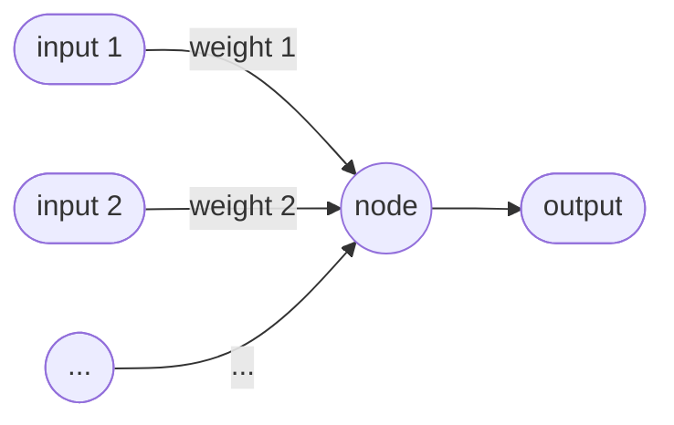

# Lia

In these notes, I will go over every concepts of the project, raising important hurdles encountered and explaining complex concepts.

## Project details

This project consists in **building a neural network (NN) in C language**, testing it, and comparing it to other known NN such as Keras. The motivation behind it is the **understanding of how an NN and everything behind it trully works**, having already experienced the more practical side with the _Blue Aria_ project. The choice of C as a programming language for the project comes from my desire to experiment on a **lower level** than with Python, and because I like it.

Every interesting document that I find will be reported in the `bibliography.md` file.

> Lia stands for ... nothing, it's just how "the AI" is pronounced in french.

The overall structure of the project will be based on the [Valisp](https://insert-link-to-valisp-github) project, conducted during a C class and orchestrated by Olivier Baldellon.

## Chapter 1: Basics

Neural Networks try to mimic how brains work : a more or less complex network of units called **neurons** process data fed into a first layer of neurons called the **input layer** and returns and **output** based on those neurons' **settings**. Most of the times, those networks consist in large (often billions) amount of neurons and tweeking all of their settings by hand is out of the question. That's why we need programming, and that's what we are going to do here.

### How a neuron works

Each neuron, regardless of its position in the network, have this structure:

> Basic structure of a neuron. Each node receive one or several input data, adjusted with a weight.

The output of a neuron is given by the following formula:
    $output = \sum_{k=i}^n \left( i_k \times w_k \right)$
    
With n the number of inputs the node is receiving.
    
However, this formula is only true for the neurons on the input layer. For any other neuron of the network, something called **bias** is added to the final output. The correct formula for every neuron except those of the input layer is therefore the following: 
    $output = \sum_{k=i}^n \left( i_k \times w_k \right) + b$

Then, each output is passed to the next neuron and so on, until the output layer is reached. 

### Variables representation

As a large amount of variables will be present in our network, we need to find a way to store and handle all of them. For this matter, the mathematical tool which will be used are **vectors**.

In fact, we can notice that the sum in each formulas described before actually is the same as the dot multiplication between two n-dimension vectors. We can then create a pattern that links every layers:
    $\left[ current\ nodes \right] \times \left[ weights \right] = next\ node$

The two vectors being represented by $1 \times n$ matrix. Thus, each node of a certain layer is connected to all the nodes of the previous layer by weights. Then, we can obtain the number of weights connecting two layers by multiplying the number ofneurons of each layer : an _i_ neurons layer is connected to a _j_ neurons layer by _ij_ weights.

When every neuron has its value, the output layer is able to provide a prediction. This prdiction is then compared to the labeled data to obtain a **cost**. This cost will allow us to verify if the model is accurate or not. The lower the cost, the better the model is.
Thanks to this data, we can then update the weights and biases of our model, in order to improve it. For that purpose, the **gradient of the cost** will be calculated after each prediction from the model.

### Calculation

> **Notation :** layers will be labeled by their index in the network, the input layer being the 0th layer. The number of nodes of a layer will be represented as $n^(\left(l\right))$. 

To calculate every value in an _l_ layer, we can use matrix multiplication : layer _l-1_ values will be stored in an $n^(\left(l-1\right)) \times 1$ matrix and weights are stored in an $n^(\left(l\right)) \times n^(\left(l-1\right))$ matrix. Multiplying those two matrix will result in an $n^(\left(l\right)) \times 1$ matrix, which then can be used for the next layer (but not before going into the **activation function**, see the next section). 

The bias matrix for the _l_th layer will be of the same dimension as the layer values matrix.

To sum it up, to get the values for the nodes in the next layer, we need to matrix multiply the weight matrix by the node values from the previous layer, and then add the bias values to the result.

### Activation Functions

Activation functions must respct two atributes :
* They must be nonlinear
* Their range must  predetermined (usually between 0 and 1)

After we get values from the matrix multiplication, we must fed our results in the function, and the resulting matrix will be our final product. A usual activation function is the _sigmoid_ function, we will use this one here too.

### Input and Output Data

The input data is called **X** and consists in a matrix which dimensions are $n \times m$, with $m$ being the number of **samples** and $n$ the number of **features**, or parameters to feed the input layer.

The labelled output data is called **y** and, the same way, consists in a matrix of dimensions $n \times m$ (with $n$ being the number of output nodes this time).

The output of our model is called **ŷ** ("y hat").

### Final Maths

Using everything we went through before, we can write maths that sum the process. 
\n
$Z^(\left[l\right]) = W^(\left[l\right]) A^(\left[l-1\right]) + B^(\left[l\right])$
\n
$A^(\left[l\right]) = g(Z^(\left[1\right]))$

**Dimensions :**
| --- | --- |
| $Z^(\left[l\right])$ | $n^(\left[l\right]) \times m$ |
| $W^(\left[l\right])$ | $n^(\left[l\right]) \times n^(\left[l-1\right])$ |
| $A^(\left[l-1\right])$ | $n^(\left[l-1\right]) \times m$ |
| $B^(\left[l\right])$ | $n^(\left[l\right]) \times 1$ |

We can notice that we cannot add the matrix multiplication result to the bias matrix, due to conflicting dimensions. To prevent that, we stretch the bias matrix by copying it m times. This process is called **broadcasting**.

## Chapter 2: Coding

### Tools

Before building any part of the network, we need to define the tools that the maths and the logic require, especially vectors.

#### 1. Vectors

One of the key elements of all the maths we defined in previous parts is matrices, some kind of vectors. There's no matrix, array or vector type in C, so we need to create one.
The solution I setled upon for this project to represent a vector from $\mathcal{m \times n}$ is a struct containing 3 fields :
* `rows` : an integer indicating the number of rows ($m$)
* `cols` : an integer indicating the number of columns ($n$)
* `data` : a unidimensionnal list of doubles
With this, we can represent any matrix we like, and access its elements with a little index trick.

Several methods are defined to manipulate those vectors. Most of them cover the basics (create, read, update and delete) and some others allow us to compare and do operations between them. Those operations are the one needed for our maths. It's worth noting that a **second constructor** was implemented, specialy to create random matrices, restraining random values between 0 and `range`. It will be used for weights and bias matrices.

